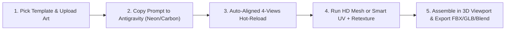

# MorphoGem Complete Step-by-Step Guide (English)

Welcome to **MorphoGem** — the open-source (MIT) visual **Node-Graph 2D-to-3D Character & Prop Studio**! This guide walks you from first-time installation to exporting your first assembled multi-part 3D model.

---

## 🌟 0. Recommended Setup & Best AI Agent Combo

For the best multi-reference vision understanding, clean orthographic 4-view generation, and seamless CLI/MCP execution:

1. **Top Recommended AI Agent: [Google Antigravity](https://antigravity.google/)**
   - **Recommended Models**: Select **`Neon`** or **`Carbon`** in the Antigravity model picker!
   - **Why**: `Neon` and `Carbon` excel at dissecting asymmetric anime character details, orchestrating clean orthographic multi-view image generation, and running MorphoGem's local alignment & registration tools reliably. *(Other agents with image generation & terminal support such as Claude Code / Cursor / Codex also work.)*
2. **Local Prerequisites**:
   - **Windows 10 / 11 (x64)**: Download the latest `MorphoGem-Setup-*.exe` from [GitHub Releases](https://github.com/MorphoDiana/MorphoGem/releases).
   - **Python 3 + Pillow** (used by `scripts/align_views.py` to punch out enclosed white holes and lock pixel baselines):
     ```powershell
     pip install pillow
     ```
   - **Blender 4.2 ~ 5.2** (recommended; required when merging all 3D parts into final `.fbx` / `.glb` / `.blend` packages).

---

## 🛠️ 1. One-Time First-Launch Setup (Takes 3 Minutes!)

After installing and launching **MorphoGem**, complete these 3 one-time steps:

### ① Copy & Install the Agent MCP Config First (Most Important!)
1. Click **`[复制 Agent 配置]` (Copy Agent Config)** on the top-right desktop bar.
2. Open **Google Antigravity** (with **`Neon`** or **`Carbon`** selected) and send this message:

   > Please install the following MorphoGem MCP server configuration into my MCP config file:
   > ```json
   > (Paste the copied JSON here)
   > ```

3. Your Agent will automatically register `tripo-studio` so it can interact seamlessly with MorphoGem's embedded daemon!

### ② Sign In Once to the Embedded Tripo Workspace
1. Click the **`[Tripo 账号工作区]`** tab on the top-left desktop bar.
2. Sign in once with your Tripo Studio account.
3. Once the status indicator turns green (`Tripo Ready`), switch back to the left studio tab (`[节点角色工坊]`). You can also click **`🌐 中文 / 🌐 EN`** on the Studio header anytime to switch the entire Studio UI and AI prompts to **English**!
   *(💡 Your login session is persisted safely inside `<InstallDir>/userdata/` across restarts and app upgrades.)*

### ③ Link Your Local `blender.exe`
1. Click the orange **`⚠ Blender`** pill on the top bar (or open **`⚙ Settings`** → **`🔍 Scan Common Install Paths`**).
2. Select your local `blender.exe` (e.g. `C:\Program Files\Blender Foundation\Blender 5.2\blender.exe`).

---

## 🚀 2. Your First 2D-to-3D Character in 5 Steps



### Step 1: Choose a Graph Template & Upload Concept Art
- Use the **Template dropdown** on the top-left of the Node Canvas (switches immediately on selection):
  - **Standard Character Split**: `Hairless Bare Head` + `Isolated Hair` + `Clothed Body` + `3-View Proportion Guide`.
  - **Deluxe 6-Part Composite**: `Bare Head + Hair + Upper Outfit + Skirt/Boots + Wings + Main Weapon`.
  - **Mask-Guided Part Extraction**: Extract intricate garments or accessories with pixel-exact Mask boundaries.
  - **Standalone Prop / Weapon**: Single 90°-upright prop workflow.
  - **🧩 Mod Templates**: e.g. the built-in **Chibi Blindbox 3-Piece Kit**.
- **📏 High-Weight Parametric Head-to-Body Ratio**: Select an exact head-to-body ratio right on the top toolbar (`2.0H`, `2.5H Blindbox`, `3.0H Chibi`, `6.8H Anime`, `7.5H Tall`, or custom `1.5~9.5H`). MorphoGem auto-generates an orthographic head-unit ruler chart PNG for AI generation and syncs 3D head-vs-body scaling in the 3D Viewport!
- **🎭 Mask-Driven Part Extraction & 🔍 4-Up Multi-View Lightbox**: Attach a B/W, alpha, or multi-color ID Mask (with built-in **`💧Pick` eyedropper**) via a **`🎭 Part Mask`** node or inline dropzone to auto-composite a `#00F0FF` contour guide. Click any view slot or **`🔍 Inspect All 4 Views`** to expand Front / Left / Right / Back side-by-side with pixel-alignment laser lines and a Magenta white-fringe backdrop!

### Step 2: Copy AI Views Prompt & Paste into Antigravity (`Neon` / `Carbon`)
1. Click **`✨ Copy AI Views Prompt`** on the canvas toolbar.
2. Only the targeted view nodes and their upstream reference inputs enter **`🔒 Locked`** protection — **you can continue freely editing, adding, or wiring any other unrelated branches on the canvas while waiting!**
3. Paste the copied prompt into **Google Antigravity (`Neon` / `Carbon`)**.
4. Antigravity reads MorphoGem's 3 original orthographic skills, generates zero-perspective `front / left / right / back` RGBA PNGs, runs `align_views.py` to clear trapped white holes and lock `topY / bottomY` baselines, and **hot-reloads the finished views straight onto your canvas nodes while unlocking them automatically**!

### Step 3: Run Tripo 3D Generation & Smart Mesh UV + Retexture
Choose the ideal mesh pipeline per part:
- **HD Model (`H3.5`, up to 5,000,000 faces)**: Best for intricate anime hair locks and detailed multi-layered outfits (`4K / 8K` textures + optional `Remove Baked Lighting`).
- **Smart Mesh (`P2.0`, clean Quad ≤25k / Triangle ≤50k) + Smart UV & Retexture**:
  - Switch any 3D node to **Smart Mesh** to unlock two built-in post-processing switches (enabled by default):
    - **`☑ Unwrap Smart UV (clean low-poly UVs)`**
    - **`☑ Auto 4-View Retexture (bake textures)`**
  - **Multi-Skin / Modular Workflow**: You can also press **`Space`** (or drag out from a 3D node's `mesh` port) to add standalone **`🎨 UV Unwrap & Retexture`** nodes (`tripo_retexture`) — letting you bake multiple alternate colorways onto the exact same clean Quad mesh without regenerating geometry!
- Click **`▶ Run Tripo 3D Nodes`** on the toolbar to execute all ready 3D & UV/Retexture nodes in topological order.

### Step 4: Fine-Tune in the 3D Assembly Viewport & Merge Export
1. Switch to **`🧍 3D Assembly Viewport`** in the center header bar.
2. Use orthographic cameras (`Front / Right / Left / Back / Top`), toggle the translucent **Ref Guide** planes, fine-tune per-part Scale / Position / Rotation in the right inspector, enter your **Target Total Height (m)** (e.g. `1.60`) and click **`Fit Height & Ground`**.
3. Choose **`PBR Standard Material`** or **`Anime Cel-Toon Material`**, then click **`📦 Merge & Export Final Assets (FBX + GLB + Blend)`**!

---

## ⌨️ 3. Blender-Style Node Canvas Shortcuts

| Shortcut / Gesture | Action |
| :--- | :--- |
| **`Space`** or **`Shift + A`** | Open Quick-Add search palette (nodes, branches, Mod nodes) |
| **Drag wire & drop on empty space** | Open context-filtered Quick-Add menu & auto-connect wire |
| **`Alt + Left-Drag` across wires** | Knife Wire Cutter (slice one or multiple connections) |
| **`Delete` / `Backspace` / `X`** | Delete selected unlocked nodes |
| **`Shift + D`** | Clone selected nodes/branch into grab-move mode |
| **`G`** | Grab free-move mode (`Click` to confirm, `Right-Click` / `Esc` to cancel) |
| **`B`** or **`Shift + Left-Drag`** | Box-select multiple nodes |
| **`F`** or **`Home`** | Frame selected nodes or fit entire graph |
| **`Ctrl + Z`** / **`Ctrl + Y`** | Undo / Redo graph edits |

---

## 🧩 4. `.mgmod` Community Mods & Safe Auto-Updates

- **Install Mods**: Drag & drop any `.mgmod` file directly onto the Node Canvas (or place it inside `<InstallDir>/Mods/`).
- **Create & Share Your Own Mod**: Click **`🧩 Mod`** → **Create & Pack Mod** to bundle your whole-graph template, selected custom branches, and custom AI craft rules (`prompt-rules.md`) into a single `.mgmod` file.
- **Zero-Data-Loss Upgrades**: Clicking **`🔄 Check Updates`** (or installing a newer `MorphoGem-Setup-*.exe`) upgrades the app while keeping `<InstallDir>/Projects/`, `Exports/`, `Mods/`, and `userdata/` 100% intact.
