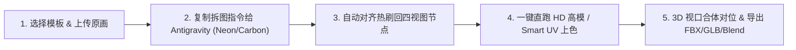

# MorphoGem 保姆级完整上手教程（简体中文）

欢迎使用 **MorphoGem（蝶双星 · 节点式 3D 角色工坊）**！本教程将手把手带你从零完成环境配置、AI 自动正交拆件、Smart UV 重展开上色到最终多部件 3D 合体导出。

---

## 🌟 0. 推荐环境与最佳 AI 搭档

为了获得最稳定、最高精度的「多参考图理解 + 正交四视图去遮挡重绘 + 命令行自动化回写」体验：

1. **首选 AI 客户端推荐：[Google Antigravity（谷歌反重力）](https://antigravity.google/)**
   - **强烈推荐模型**：在 Antigravity 右下角模型选择器中优先选用 **`Neon`** 或 **`Carbon`** 模型！
   - **推荐原因**：`Neon` 与 `Carbon` 具备极强的多模态立绘结构理解能力、高一致性四视图生图子代理调度能力，以及稳定的本地脚本与 MCP 调用能力。*(其他支持生图与本地终端的 Agent 如 Claude Code / Cursor / Codex 亦可兼容使用。)*
2. **本机基础软件**：
   - **Windows 10 / 11 (x64)**：前往 [GitHub Releases](https://github.com/MorphoDiana/MorphoGem/releases) 下载最新 `MorphoGem-Setup-*.exe` 安装包。
   - **Python 3 + Pillow**（用于运行内置四视图像素级对齐与内孔去白脚本）：
     ```powershell
     pip install pillow
     ```
   - **Blender 4.2 ~ 5.2**（推荐安装，用于最终多部件合并导出 `.fbx` / `.glb` / `.blend`）。

---

## 🛠️ 1. 首次启动必做的 3 分钟初始化（仅需一次！）

安装并双击桌面上的 **MorphoGem** 图标启动后，请按顺序完成以下 3 件一次性配置：

### ① 先复制 Agent 配置发给反重力自动安装（最关键！）
1. 点击 MorphoGem 客户端**最顶栏右侧**的 **`[复制 Agent 配置]`** 按钮（按钮会变绿提示 `✓ 已复制 MCP 配置`）。
2. 打开 **Google Antigravity**（确认模型已选为 **`Neon`** 或 **`Carbon`**），直接在对话框粘贴并发送以下话术：

   > 请帮我把下面这段 MorphoGem 的 MCP 服务配置安装写入到我的 MCP 配置文件中：
   > ```json
   > （在这里直接 Ctrl+V 粘贴刚才复制的内容）
   > ```

3. Agent 会自动帮你把 `tripo-studio` 写入配置，之后无论是客户端直跑还是让 Agent 跨工具操控 Tripo 建模都畅通无阻！

### ② 在内置工作区登录一次 Tripo Studio
1. 点击客户端**最顶栏左上角**的 **`[Tripo 账号工作区]`** 标签页。
2. 支持两种方式登录：**直接使用「邮箱 + 密码 / 邮箱验证码」登录**（最快）；或点击页面内的 **Google 登录**（客户端会自动拉起本机独立的 Chrome / Edge 浏览器窗口完成 Google 授权，登录成功后自动关闭窗口并将会话无缝同步回客户端）。
3. 看到顶栏绿灯亮起显示 **`Tripo 已就绪 · 积分 xxx`** 后，切回左侧 **`[节点角色工坊]`** 即可！
   *(💡 登录态 Cookie 会自动加密持久保存在安装目录 `userdata/` 下，以后打开软件无需重复登录，升级客户端也不会掉登录！)*

### ③ 绑定本机 Blender 路径
1. 点击顶栏橙色胶囊 **`⚠ 点击配置 Blender 路径`**（或点击右上角 **`⚙ 设置`** → **`🔍 自动扫描本机常见安装路径`**）。
2. 选中你电脑上的 `blender.exe`（例如 `C:\Program Files\Blender Foundation\Blender 5.2\blender.exe`），状态变为绿色 **`✓ Blender 已连接`** 即大功告成！

---

## 🚀 2. 五步跑通你的第一个 3D 角色



### 第 1 步：选择整图模板并上传参考图
- 在画布左上角**模板下拉框**直接选择适合你目标的拓扑（选中即刻切换）：
  - **精细角色拆分**：`无发裸脸` + `独立头发与发饰` + `服装身体` + `全身比例三视图`（最推荐二次元角色标准流）。
  - **豪华多件复合**：一键拆出 `裸脸 + 头发 + 上衣 + 下裙 + 背部翅膀 + 主武器` 六大独立高精部件。
  - **Mask 遮罩精准拆件**：通过一张或多张 Mask 遮罩图精准指定复杂多层服饰/配件的拆解边界。
  - **自由单件 / 道具**：适合独立宝剑、法杖、潮玩摆件、宠物等单主体。
  - **🧩 Mod 扩展模板**：如内置的 **Q版盲盒三件套（2.5头身大头 + 插栓身体 + 配件）**。
- **📏 锁定参数化头身比（高权重！）**：相比低权重的识图参考，直接在画布顶栏选择 **`2.0 / 2.5 / 3.0 / 4.0 / 6.8 / 7.5` 头身或自定义数值**，系统会自动生成正交头身比分格标尺图并以硬性解剖公式约束 AI 生图，同时在 3D 视口支持一键重配头身比例！
- **🎭 使用 Mask 图精准拆件（可选）**：既可以添加 **`🎭 Mask 分区遮罩图`** 节点连入多个拆图节点（支持一张多色 ID Mask 通过 **`💧吸色`** 拆分多个部位），也可以直接在单个拆图节点内拖入黑白或透明遮罩图，自动合成高亮轮廓引导图。
- **🔍 一键同屏展开全部视图对比**：点击节点上的任意视图缩略图或 **`🔍 同屏展开四视图对比`** 按钮，即可同屏并排检视 `正 / 左 / 右 / 背` 全部大图，开启像素上下对齐激光线或切换**品红底色**一秒排查漏抠白边！
- 你也可以随时双击修改每个拆图节点的部件名称、补充提示词（例如*“去掉披风露出后背蝴蝶结”*），或按 **`Space` 键**自由增删部件分支！

### 第 2 步：复制 AI 拆图指令交给 Antigravity（`Neon` / `Carbon`）
1. 点击画布工具栏蓝色的 **`✨ 复制 AI 拆图指令`**（若只想重拆某一个部位，可点该卡片底部的 `仅复制此节点拆图指令`）。
2. 此时你会看到本次涉及的拆图节点戴上了 **`🔒 锁定`** 保护徽章——**而画布上其他未锁定的节点和分支你依然可以边等边自由拖拽、调参或新增**！
3. 打开 **Google Antigravity（`Neon` / `Carbon`）**，将你的工作目录打开或直接粘贴刚才自动复制好的长指令并发送。
4. **全自动回填**：Agent 会自动阅读 MorphoGem 内置的三大原创正交拆件 Skill，读取你的原画，依次绘制无透视、去遮挡的 `正 / 左 / 右 / 背` 透明底 PNG，自动运行 `align_views.py` 挖空发环/蝴蝶结闭合白斑并锁死上下像素基准线，最后**自动热刷新回你的画布节点并解除锁定**！

### 第 3 步：配置并运行 Tripo 3D 建模与 Smart UV 上色
四方向视图全部就绪后，你可以为不同性质的部件灵活选择两种建模管线：

- **路线 A：高精度百万面模式 (`高精度 HD · H3.5`)**
  - 适合复杂二次元多层长发、精致蕾丝服饰褶皱。
  - 可自由设定 `30万 ~ 500万` 面数上限、`4K / 8K` 贴图，二次元角色强烈建议勾选 **`☑ 去除烘焙高光与阴影`**。
- **路线 B：智能低模拓扑 + 重展开 UV 上色 (`Smart 智能拓扑 · P2.0`)**
  - 适合硬表面刀剑枪械、游戏实时低模或需要规整四边面（`Quad ≤2.5万面` / `Triangle ≤5万面`）的部件。
  - 切换到 `Smart 智能拓扑` 后，卡片会自动展开青色专属面板（默认全开）：
    - **`☑ 重展开 Smart UV（规整低模 UV 岛）`**
    - **`☑ 四视图自动上色（Retexture 烘焙贴图）`**
  - **进阶一模多皮玩法**：如果你先取消勾选自动上色跑出了一个满意的纯四边面白模，还可以从它的输出口拖出连线松手，创建多个独立的 **`🎨 UV 重展开与贴图上色`** 节点，分别连入不同配色的四视图，无需重跑网格即可快速出多套换色皮肤！

点击单个节点上的 **`▶ 直接在 Tripo 生成此 3D 部件`**，或点击画布右上角绿色的 **`▶ 一键直跑 3D 节点`**，客户端就会在后台静默操控内置 Tripo 视图完成生成、UV 展开、贴图烘焙并自动下载入库！

### 第 4 步：切换至「3D 合体对位视口」微调与导出
1. 点击窗口正上方切换栏的 **`🧍 3D 合体对位视口`**。
2. 点击左上角相机栏的 **`正视 / 右视 / 左视 / 背视 / 顶视`** 切换零透视正交相机，开启 **`比例垫图`** 对照全身三视图标尺。
3. 在右侧检查器点选任意部件（或直接在 3D 画面里点击模型部件），拖动滑块或输入精确数值微调其 **缩放、左右 X、高低 Z、前后 Y 与三轴旋转**。
4. 在右下角输入 **`目标总身高 (m)`**（如 `1.62`）并点击 **`校准总高与贴地`**，所有部件将自动等比缩放到真实米制身高并严丝合缝站在 `Y=0` 地面网格上。
5. 选择 **`PBR 标准材质`** 或 **`Anime Toon 二次元赛璐璐材质`**，点击绿色大按钮 **`📦 合并导出最终模型 (FBX + GLB + Blend)`**！导出压缩包会自动存入安装目录下的 `Exports/` 文件夹（同时在顶栏弹出绿色定位提示）。

---

## ⌨️ 3. 节点画布快捷键速查表（Blender 风格）

| 快捷键 / 手势 | 功能说明 |
| :--- | :--- |
| **`Space`** 或 **`Shift + A`** | 在鼠标位置弹出浮动搜索面板，秒加基础节点、个人分支或 Mod 专属节点 |
| **从端口拖线到空白处松手** | 自动弹出仅显示“端口类型兼容”节点的快捷创建菜单，选中即创建并自动连线 |
| **`Alt + 左键按住划过连线`** | 连线切割小刀（划过一条或多条贝塞尔连线即可潇洒切断） |
| **`Delete` / `Backspace` / `X`** | 删除当前选中的未锁定节点 |
| **`Shift + D`** | 原地克隆选中的节点/分支并自动进入跟随鼠标移动状态 |
| **`G`** | Blender 同款抓取自由移动模式（左键确认落点，右键或 `Esc` 取消回退） |
| **`B`** 或 **`Shift + 左键拖拽`** | 矩形框选多个节点 |
| **鼠标滚轮 / 中键拖拽** | 以鼠标为中心无级缩放画布 / 平移画布（左键拖空白处也可平移） |
| **`F`** 或 **`Home`** | 聚焦放大当前选中节点（未选中时自动居中适应全图） |
| **`Ctrl + Z`** / **`Ctrl + Y`** | 多步撤销 / 重做节点增删改连操作 |

---

## 🧩 4. 社区 `.mgmod` 模组安装与制作分享

- **安装他人分享的 `.mgmod`**：
  - 直接把 `.mgmod` 文件**拖拽进 MorphoGem 节点画布**即可一键安装并启用！
  - 或者放入安装目录下的 `Mods/` 文件夹，再点击工具栏 **`🧩 Mod`** → **`🔄 热重载扫描`**。
- **把自己的工作流打包分享给朋友**：
  1. 在画布上搭好你满意的节点结构（也可以框选某一组特色分支）。
  2. 点击画布工具栏 **`🧩 Mod`** → 切换到 **`📦 打包制作我的 Mod`**。
  3. 填写 Mod 名称、作者署名，并可在下方文本框写下你的**专属 AI 拆图秘籍**（启用该 Mod 时会自动注入给 Antigravity！）。
  4. 点击 **`📦 打包导出 .mgmod 分享文件`**，即可生成单个轻量 `.mgmod` 文件发到群里或社区交流！

---

## ❓ 5. 常见问题排查 (FAQ)

1. **切换或升级新版本客户端后，我之前的角色工程、Mod 和 Tripo 登录会丢吗？**
   - **绝对不会！** MorphoGem 的安装/卸载脚本专门对安装目录下的 `Projects/`、`Exports/`、`Mods/` 和 `userdata/` 做了保留保护，直接双击新安装包覆盖升级，或者点击顶栏 **`🔄 检查更新`** 在线增量更新都是 100% 无损的。
2. **AI 拆图中途报错或我不小心中断了对话，画布上的节点一直显示 `🔒 锁定` 怎么办？**
   - 直接点击画布上方状态横幅右侧红色的 **`取消锁定`**（或点击指令弹窗里的 **`🔓 取消本次任务并解锁节点`**），即可一秒手动释放全部节点锁！
3. **点击「一键直跑 3D 节点」提示未检测到就绪状态？**
   - 请点开最顶栏的 **`[Tripo 账号工作区]`** 看一眼是否首次未登录，或遇到了网页端人机验证框；人工点一下验证看到工作区恢复正常后，切回工坊重新点运行即可。
